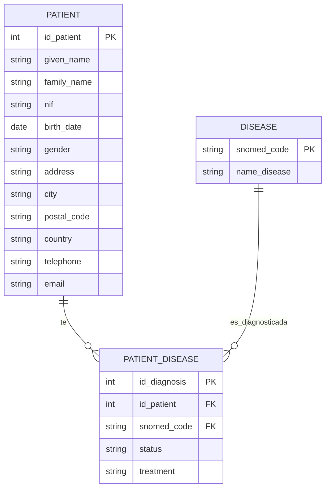
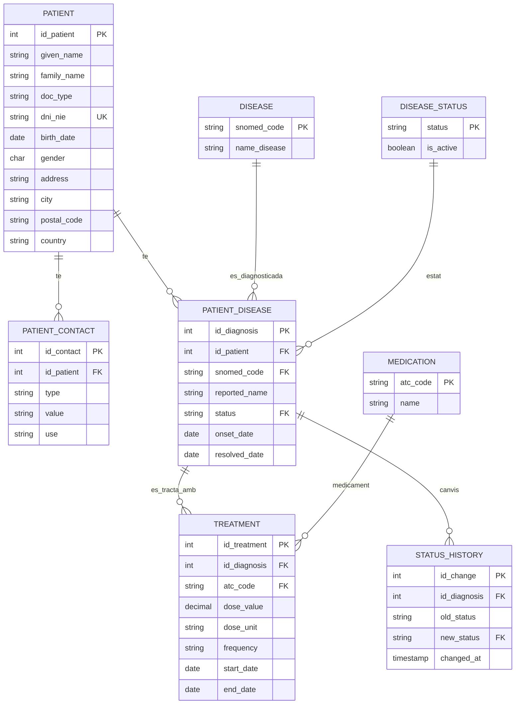

# FiSioFiNo – Activitat RA2 (Accés a dades)

Aplicació Java (Maven, patró MVC) que llegeix l'historial de salut dels pacients en format XML (estil Blue Button / C-CDA) amb **DOM** i el guarda en una base de dades **PostgreSQL** mitjançant **JDBC** amb un pool de connexions **HikariCP**.

## Vídeo demostratiu

▶️ **[Enllaç al vídeo](POSA_AQUI_L_ENLLAÇ)**

## Funcionalitats

| Opció | Descripció |
| --- | --- |
| 1 | Carregar la informació del fitxer XML (pacients, malalties i diagnòstics, sense duplicats) |
| 2 | Consultar la informació personal d'un pacient per DNI/NIE |
| 3 | Consultar la informació mèdica d'un pacient per DNI/NIE |
| 4 | Consultar tots els pacients |
| 5 | Modificar l'estat de la malaltia d'un pacient |

## Posada en marxa

### 1. Base de dades (Docker)

La base de dades és un contenidor PostgreSQL 16 propi. L'script `docker/init/01-schema.sql` crea les taules la primera vegada que s'arrenca.

```bash
cd docker
docker compose up -d
```

| Paràmetre | Valor |
| --- | --- |
| Host | `localhost` |
| Port | `5433` |
| Base de dades | `fisiofino` |
| Usuari / contrasenya | `fisiofino` / `fisiofino` |

Per esborrar les dades i tornar a començar: `docker compose down -v` i `docker compose up -d`.

### 2. Configuració de la connexió

Les dades de connexió són a `src/main/resources/db.properties`:

```properties
db.url=jdbc:postgresql://localhost:5433/fisiofino
db.user=fisiofino
db.password=fisiofino
db.pool.size=4
```

### 3. Execució

Executar la classe `com.fisiofino.Main`. A l'opció 1, prémer Enter per carregar `pacientes_bluebutton.xml` (a l'arrel del projecte).

## Estructura del projecte

```
dam2-fisiofino/
├── docker/                     Base de dades (docker-compose + script SQL)
├── src/main/java/com/fisiofino/
│   ├── Main.java               Inicia la connexió, la vista i el controlador
│   ├── LectorXML.java          Lectura de l'XML amb DOM (recorregut recursiu)
│   ├── controlador/            Controller: coordina vista, BD i XML
│   ├── database/               Connexio (pool HikariCP) i GestioPacients (consultes JDBC)
│   ├── model/                  Pacient i MalaltiaPacient
│   └── vista/                  MenuView: entrada i sortida per consola
├── src/main/resources/         db.properties
└── pacientes_bluebutton.xml    Fitxer de prova
```

---

## Proposta de millora del model relacional

Durant el desenvolupament he detectat diverses limitacions del model proposat. Cada millora parteix d'un problema concret trobat a l'XML o a l'aplicació.

### Model actual



### Millora 1 – Els tractaments en taules pròpies

**Problema.** El camp `treatment` és un text lliure. Per guardar-hi la informació de l'XML hem hagut d'ajuntar diversos medicaments en una sola cadena:

```
Budesonida inhalada 200 mcg, Cada 12 h; Salbutamol inhalado 100 mcg, A demanda
```

Amb aquest format:
- No es pot consultar "quins pacients prenen Enalapril?" sense buscar dins del text.
- Es perd el codi ATC del medicament, que l'XML sí que porta (`<medication code="C09AA02">`).
- Es perden les dates d'inici i de fi. Per exemple, el paracetamol del refredat de la pacient 3 té `endDate`: ja no el pren, però el model no ho pot reflectir. L'enunciat demana guardar la medicació que el pacient **pren actualment**.

**Proposta.** Una taula `medication` (catàleg de medicaments pel codi ATC, igual que `disease` amb el codi SNOMED) i una taula `treatment` amb una fila per medicament de cada diagnòstic:

```sql
CREATE TABLE medication (
    atc_code   VARCHAR(10)  PRIMARY KEY,
    name       VARCHAR(150) NOT NULL
);

CREATE TABLE treatment (
    id_treatment  SERIAL PRIMARY KEY,
    id_diagnosis  INTEGER      NOT NULL REFERENCES patient_disease(id_diagnosis) ON DELETE CASCADE,
    atc_code      VARCHAR(10)  NOT NULL REFERENCES medication(atc_code),
    dose_value    NUMERIC(8,2),
    dose_unit     VARCHAR(10),
    frequency     VARCHAR(50),
    start_date    DATE,
    end_date      DATE
);
```

**Benefici.** La medicació actual és simplement `WHERE end_date IS NULL`, i es poden fer consultes per medicament:

```sql
SELECT p.given_name, m.name, t.dose_value, t.dose_unit
FROM treatment t
JOIN medication m       ON t.atc_code = m.atc_code
JOIN patient_disease pd ON t.id_diagnosis = pd.id_diagnosis
JOIN patient p          ON pd.id_patient = p.id_patient
WHERE t.atc_code = 'C09AA02';   -- Enalapril
```

### Millora 2 – Catàleg d'estats

**Problema.** `status` és un text lliure. L'aplicació compara amb la cadena `"Activo"` per saber si una malaltia està activa, així que:
- Un error en escriure l'estat a l'opció 5 (`activo`, `Actiu`...) es guarda sense cap avís i després la validació ja no el reconeix.
- No queda definit quins estats compten com a "actius". Per exemple, una malaltia `Controlado` (l'asma de la pacient 1) continua sent una malaltia vigent.

**Proposta.** Una taula `disease_status` amb els estats vàlids, i `status` passa a ser una clau forana:

```sql
CREATE TABLE disease_status (
    status     VARCHAR(20) PRIMARY KEY,
    is_active  BOOLEAN     NOT NULL
);

INSERT INTO disease_status VALUES
    ('Activo', true), ('Controlado', true), ('Resuelto', false);

-- a patient_disease:
status VARCHAR(20) NOT NULL REFERENCES disease_status(status)
```

**Benefici.** La base de dades rebutja qualsevol estat que no existeixi (provat: `activo` en minúscula dona error de clau forana), i el camp `is_active` defineix en un sol lloc quins estats són actius.

### Millora 3 – Un sol diagnòstic actiu, garantit per la base de dades

**Problema.** L'enunciat diu que un pacient no pot tenir dues vegades la mateixa malaltia activa. Ara aquesta regla només la comprova l'aplicació (`findMalaltiaPacient`). Si s'insereix des d'un altre programa, o directament amb SQL, la regla no es compleix.

**Proposta.** Un índex únic parcial, que només s'aplica a les files actives:

```sql
CREATE UNIQUE INDEX uq_diagnostic_actiu
    ON patient_disease (id_patient, snomed_code)
    WHERE status = 'Activo';
```

**Benefici.** Es poden tenir diversos diagnòstics resolts de la mateixa malaltia (historial), però mai dos d'actius alhora. Provat: el segon `INSERT` actiu dona `duplicate key value violates unique constraint "uq_diagnostic_actiu"`.

### Millora 4 – Dates i nom original del diagnòstic

**Problema.**
- L'XML porta la data d'inici de cada problema (`<onset value="20210601"/>`), però el model no la pot guardar. Pel fisioterapeuta és important saber des de quan el pacient té una malaltia.
- El mateix codi SNOMED arriba amb noms diferents: `38341003` és "Hipertensión arterial" als pacients 1 i 2, i "HTA" als pacients 4 i 5. Com que `disease` guarda un sol nom per codi, el nom que va escriure el metge es perd.

**Proposta.** Afegir tres columnes a `patient_disease`:

```sql
reported_name  VARCHAR(255),   -- nom tal com apareix a l'XML ("HTA")
onset_date     DATE,           -- <onset>
resolved_date  DATE            -- quan passa a 'Resuelto'
```

**Benefici.** `disease.name_disease` continua sent el nom oficial i únic, i a cada diagnòstic es conserva el nom original i les dates.

### Millora 5 – Historial de canvis d'estat

**Problema.** L'opció 5 fa un `UPDATE` que sobreescriu l'estat anterior. Un cop modificat, no se sap quin era l'estat abans ni quan va canviar.

**Proposta.**

```sql
CREATE TABLE status_history (
    id_change     SERIAL PRIMARY KEY,
    id_diagnosis  INTEGER     NOT NULL REFERENCES patient_disease(id_diagnosis) ON DELETE CASCADE,
    old_status    VARCHAR(20),
    new_status    VARCHAR(20) NOT NULL REFERENCES disease_status(status),
    changed_at    TIMESTAMP   NOT NULL DEFAULT CURRENT_TIMESTAMP
);
```

`updateStatus` inseriria una fila en aquesta taula a més de fer l'`UPDATE`.

**Benefici.** Traçabilitat de l'evolució de cada malaltia, important en dades de salut.

### Millora 6 – Contactes i document d'identitat

**Problema.**
- Un pacient pot tenir zero, un o diversos telèfons i correus (`<telecom>` es pot repetir). Les columnes fixes `telephone` i `email` només en permeten un de cada; als pacients 4 i 5 l'email queda `NULL`.
- La columna es diu `nif`, però hi guardem DNI o NIE, i no se sap quin tipus de document és.

**Proposta.**

```sql
CREATE TABLE patient_contact (
    id_contact  SERIAL PRIMARY KEY,
    id_patient  INTEGER      NOT NULL REFERENCES patient(id_patient) ON DELETE CASCADE,
    type        VARCHAR(10)  NOT NULL CHECK (type IN ('TEL', 'EMAIL')),
    value       VARCHAR(150) NOT NULL,
    use         VARCHAR(10)          -- 'HP' (casa), 'WP' (feina)...
);

-- a patient:
doc_type  VARCHAR(3)  NOT NULL CHECK (doc_type IN ('DNI', 'NIE')),
dni_nie   VARCHAR(15) NOT NULL UNIQUE,
gender    CHAR(1)     CHECK (gender IN ('F', 'M', 'U'))
```

**Benefici.** Tants contactes com calgui, sense columnes buides, i validació del tipus de document i del gènere a la base de dades.

### Model proposat



### Resum

| # | Problema detectat | Millora |
| --- | --- | --- |
| 1 | Medicaments barrejats en un text; es perd el codi ATC i si encara es pren | Taules `medication` i `treatment` |
| 2 | Estats en text lliure; errors tipogràfics acceptats | Taula `disease_status` amb `is_active` |
| 3 | La regla "un sol diagnòstic actiu" només la controla l'aplicació | Índex únic parcial |
| 4 | Es perd la data d'inici i el nom original ("HTA") | `onset_date`, `resolved_date`, `reported_name` |
| 5 | L'`UPDATE` d'estat esborra l'estat anterior | Taula `status_history` |
| 6 | Un sol telèfon/email; no se sap si és DNI o NIE | Taula `patient_contact`, `doc_type`, `CHECK` |

Totes les sentències SQL d'aquesta proposta s'han provat sobre PostgreSQL 16.
